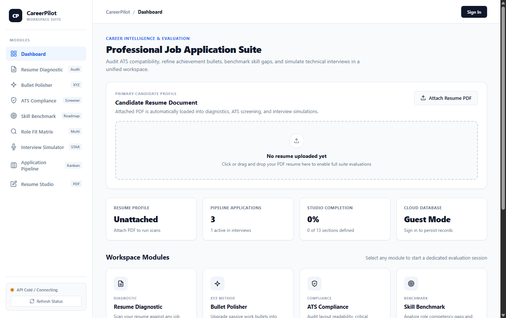
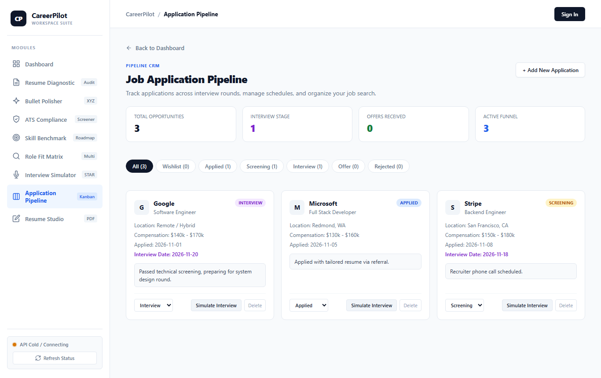

# CareerPilot AI 🚀

**An AI-powered Job Application Copilot that guides job seekers through every stage of their career journey.**

CareerPilot AI is a full-stack platform featuring resume analysis, description rewriting, ATS compatibility audits, skill gap roadmapping, job application tracking, and interactive AI mock interviews.

---

## 📸 Application Previews

| Professional Job Application Suite | Interactive Kanban Application Pipeline |
| :---: | :---: |
|  |  |

---

## ✨ Complete Feature Matrix (All 8 Milestones)

| # | Feature / Milestone | Description | Status |
|---|---------------------|-------------|:------:|
| **01** | **AI Resume Coach** | Rewrite passive bullet points into high-impact descriptions using the Google XYZ formula and quantifiable metrics. | 🟢 **Complete** |
| **02** | **ATS Compatibility Checker** | Comprehensive audit: ATS score (0-100), layout formatting checks, section header detection, and missing job requirements. | 🟢 **Complete** |
| **03** | **User Authentication** | Secure signup, login, JWT token auth, bcrypt password hashing, and user sessions. | 🟢 **Complete** |
| **04** | **Database Integration** | SQLite & PostgreSQL ORM (SQLAlchemy) to persist user profiles, resumes, analyses, and applications. | 🟢 **Complete** |
| **05** | **Job Application Tracker** | Kanban-style pipeline tracker (Wishlist ➔ Applied ➔ Screening ➔ Interview ➔ Offer ➔ Rejected) with notes & interview dates. | 🟢 **Complete** |
| **06** | **AI Mock Interview** | Personalized interview questions generator + interactive real-time answer evaluation and STAR critique. | 🟢 **Complete** |
| **07** | **Skill Gap Analyzer** | Detailed skill match breakdown with critical missing skills and a personalized 4-week learning curriculum. | 🟢 **Complete** |
| **08** | **Live Deployment** | Production-ready with Dockerfile, Procfile, locked `requirements.txt`, Vercel config, and full deployment guide. | 🟢 **Complete** |

---

## 🛠️ Tech Stack

- **Frontend**: React 19, Vite, Axios, jsPDF, Modern CSS3
- **Backend**: Python 3.11, FastAPI, SQLAlchemy ORM, PyMuPDF, PyJWT, Bcrypt
- **AI Engine**: Groq Cloud API (`openai/gpt-oss-20b`)
- **Database**: SQLite (local) / PostgreSQL (production)
- **Deployment**: Render / Railway (Backend) + Vercel / Netlify (Frontend) + Docker

---

## 📁 Project Structure

```text
AI-Job-Copilot/
├── backend/
│   ├── main.py                  # FastAPI server with all 8 module endpoints
│   ├── database.py              # SQLAlchemy engine & session setup
│   ├── models.py                # Database ORM models (User, Resume, JobApp, etc.)
│   ├── schemas.py               # Pydantic request & response schemas
│   ├── auth.py                  # Password hashing & JWT verification
│   ├── requirements.txt         # Locked Python dependencies
│   ├── Dockerfile               # Production container image
│   ├── Procfile                 # Process file for Render/Railway
│   └── test_api_auth.py         # Automated API test suite
├── frontend/
│   ├── src/
│   │   ├── App.jsx              # Unified React dashboard with all 8 modules
│   │   ├── App.css              # Custom responsive styles & animations
│   │   └── main.jsx
│   ├── vercel.json              # Vercel deployment rewrite rules
│   ├── package.json
│   └── index.html
├── DEPLOYMENT.md                # Step-by-step live deployment instructions
├── .gitignore
└── README.md
```

---

## ⚙️ Local Development Setup

### 1. Clone & Enter Repository

```bash
git clone https://github.com/VanshGour/CareerPilot-AI.git
cd CareerPilot-AI
```

### 2. Backend Setup

```bash
cd backend
python -m venv venv
.\venv\Scripts\Activate.ps1   # On Windows (or source venv/bin/activate on Linux/Mac)
pip install -r requirements.txt
```

Create a `.env` file inside `backend/`:
```env
GROQ_API_KEY=your_groq_api_key
GROQ_MODEL=openai/gpt-oss-20b
JWT_SECRET_KEY=a_random_32_character_secret_string
DATABASE_URL=sqlite:///./careerpilot.db
```

Start the backend:
```bash
python -m uvicorn main:app --reload
```
- API runs at: `http://127.0.0.1:8000`
- Interactive Swagger docs at: `http://127.0.0.1:8000/docs`

### 3. Frontend Setup

In a new terminal:
```bash
cd frontend
npm install
npm run dev
```
- Frontend runs at: `http://localhost:5173`

### 4. Health Check Verification

Verify backend service connectivity:
```bash
curl http://127.0.0.1:8000/health
# Returns: {"status":"running","project":"AI Job Application Copilot"}
```

---

## 🚀 Live Cloud Deployment

Read **[DEPLOYMENT.md](DEPLOYMENT.md)** for instructions on deploying the backend to **Render / Railway** and frontend to **Vercel / Netlify**.

---

## 👨‍💻 Author

**Vansh Gour** — [GitHub Profile](https://github.com/VanshGour) · [LinkedIn](https://linkedin.com/in/vansh-gour-3632b0292)
